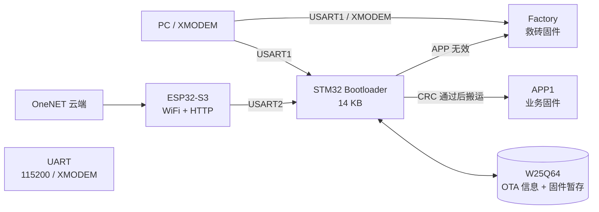

# STM32 OTA Bootloader

一套可直接学习和复用的 **STM32F103C8T6 现场升级方案**：由 Bootloader 管理分区，W25Q64 负责固件暂存，Factory 提供串口救砖能力，ESP32-S3 则把 OneNET 云端固件通过 WiFi 和 XMODEM 转发给 STM32。


> 目标不是演示一个“能跳转”的函数，而是把固件接收、暂存、校验、搬运、掉电保护和救砖流程串成一条完整链路。

## 项目能做什么

- 通过 PC 串口发送 XMODEM，将新固件写入外部 W25Q64，再由 Bootloader 搬到 STM32 内部 Flash。
- 通过 ESP32-S3 从 OneNET 流式下载固件，经 UART 边下载、边发送，不需要把固件存入 ESP32 Flash。
- 当 APP 损坏或升级中断时，进入 Factory 恢复程序，直接通过串口重写 APP，不依赖 W25Q64。
- 使用整包 CRC32、XMODEM CRC16、写后回读和更新中标志，降低半包固件被启动的风险。

## 系统架构



## 核心特性

| 能力 | 实现 |
|---|---|
| OTA 暂存 | W25Q64 独立 128 KB 固件暂存区 |
| OTA 元数据 | 主、备两份记录，带序号与 CRC32 |
| 下载协议 | XMODEM-128，CRC16-CCITT |
| 整包校验 | CRC32-IEEE，与 PC `zlib.crc32` 一致 |
| 掉电保护 | APP 更新中标志，未完成时禁止启动 APP1 |
| 救砖恢复 | Factory 不依赖 W25Q64，直接擦写 APP1 |
| 无线升级 | ESP32-S3 + OneNET + HTTPS 流式转发 |
| 分区管理 | `common/partition_layout.h` 单一配置来源 |

## Flash 分区

目标芯片为 **STM32F103C8T6，64 KB Flash，20 KB SRAM**。

| 区域 | 起始地址 | 大小 | 用途 |
|---|---:|---:|---|
| Bootloader | `0x08000000` | 14 KB | 菜单、校验、固件搬运、启动选择 |
| Factory | `0x08003800` | 10 KB | 串口救砖与直接恢复 APP1 |
| APP1 | `0x08006000` | 18 KB | 正常运行的应用固件 |
| APP2 / 状态区 | `0x0800A800` | 22 KB | 首 1 KB 为更新状态，其余预留 |

分区地址统一定义在 [`common/partition_layout.h`](common/partition_layout.h)，不要在应用工程中复制地址常量。

## 三条升级路径

### 1. PC 串口升级

```text
PC --XMODEM--> Bootloader --> W25Q64 暂存 --> CRC32 校验 --> APP1
```

复位 STM32 后 3 秒内发送 `w` 进入菜单，选择 `[1]`。

### 2. OneNET 无线升级

```text
OneNET --HTTPS--> ESP32-S3 --UART2/XMODEM--> Bootloader --> W25Q64 --> APP1
```

STM32 进入菜单 `[7]`，ESP32-S3 检测到 STM32 发出的 `C` 后开始传输。若使用 PC 串口，则选择 `[1]`。

### 3. Factory 救砖

```text
PC --USART1/XMODEM--> Factory --> 直接擦写 APP1
```

Factory 不访问 W25Q64，因此外部 Flash 未接、损坏或暂存数据无效时，仍可恢复 APP。

## 目录结构

```text
.
├─ common/                 公共分区、OTA 信息、W25Q64 与 SPI 驱动
├─ bootloader/             Bootloader 工程
├─ factory/                Factory 救砖工程
├─ app1/                   APP v1.0.0 工程
├─ app_test_v110/          APP v1.1.0 测试升级包
├─ esp32_ota_bridge/       ESP32-S3 OneNET OTA 桥接工程
├─ docs/
│  └─ MODULE_ARCHITECTURE.md
└─ README.md
```

STM32 各子工程相互独立，但共享 `common/` 中的分区、OTA 元数据和 W25Q64 驱动。

## 硬件连接

### ESP32-S3 ↔ STM32

| ESP32-S3 | STM32F103C8T6 | 说明 |
|---|---|---|
| GPIO17 / TX | PA3 / USART2_RX | ESP32 发送数据 |
| GPIO18 / RX | PA2 / USART2_TX | ESP32 接收 ACK/C/NAK |
| GND | GND | 必须共地 |
| 3V3 | 3V3 | 两侧均为 3.3 V |

### W25Q64 ↔ STM32

| W25Q64 | STM32 |
|---|---|
| CS | PA4 |
| SCK | PA5 |
| MISO | PA6 |
| MOSI | PA7 |

串口默认波特率为 **115200**。W25Q64 当前使用 GPIO 软件 SPI Mode 0，引脚宏集中定义在 [`common/drivers/MySPI.h`](common/drivers/MySPI.h)。

## 编译

### STM32

使用 **Keil MDK 5（ARM-ADS）** 分别打开并编译：

```text
bootloader/template.uvprojx
factory/template.uvprojx
app1/template.uvprojx
app_test_v110/template.uvprojx
```

首次使用时请检查每个工程的：

- 目标芯片是否为 `STM32F103C8`
- IROM / IRAM 地址与 `common/partition_layout.h` 是否一致
- APP 工程的起始地址是否为 `0x08006000`
- Debugger 与下载算法是否匹配实际开发板

构建产物位于各工程的 `Objects/`、`Listings/`，已被 `.gitignore` 排除。

### ESP32-S3

需要安装 **ESP-IDF**，并支持目标芯片 `esp32s3`：

```bash
cd esp32_ota_bridge
idf.py set-target esp32s3
idf.py build
idf.py -p COMx flash monitor
```

ESP-IDF 的 `build/`、`sdkconfig` 和本地凭证均已排除。

## 配置 WiFi 与 OneNET

仓库不会上传真实凭证。首次编译 ESP32-S3 前：

```text
把 esp32_ota_bridge/main/app_secrets.example.h
复制为 esp32_ota_bridge/main/app_secrets.h
```

然后填写：

- `ONENET_PRODUCT_ID`
- `ONENET_ACCESS_KEY`
- `ONENET_DEVICE_NAME`
- `WIFI_SSID`
- `WIFI_PASSWORD`
- `ONENET_TOKEN_TIMESTAMP`

`app_secrets.h` 已加入 `.gitignore`，请勿强制提交。

## 快速体验流程

1. 烧录 Bootloader、Factory 和 APP1。
2. 用串口工具连接 USART1，波特率 `115200`。
3. 复位 STM32，在 3 秒窗口内发送 `w`。
4. 有线升级选择 `[1]`；ESP32 无线升级选择 `[7]`。
5. XMODEM 发送 `app_v110.bin`，等待 CRC 校验和复位。
6. APP 启动后，根据 LED 节奏判断版本：
   - v1.0.0：1000 ms 慢闪
   - v1.1.0：200 ms 快闪

## 可靠性设计

- XMODEM 检测块号、反码、CRC16、重复块和取消信号。
- W25Q64 写入前检查地址、自动拆分 256 B 页，并在擦除/写入后回读校验。
- OTA 元数据采用主备记录和递增序号，优先读取最新有效记录。
- Bootloader 在搬运前后分别校验整包 CRC32。
- 更新开始前写“APP 更新中”标志；搬运或 Factory 恢复成功后才会清除。
- APP 入口校验会检查 MSP、Reset_Handler、分区边界和 Thumb 位。
- 云端声明大小、实际下载大小和 XMODEM 已发送大小必须一致。

## 当前版本与限制

- 当前 APP2 主要作为更新状态页和预留区，尚未实现真正的 A/B 无感切换。
- ESP32-S3 中的 `STM32_CURRENT_VERSION` 目前需要手动同步 STM32 实际版本。
- OneNET 中已完成的同一个任务不能重复下载，需要新建 OTA 任务。
- 目前只校验完整性，尚未加入固件数字签名或安全启动。

更详细的模块职责、启动流程、缓冲区和错误处理请查看 [`docs/MODULE_ARCHITECTURE.md`](docs/MODULE_ARCHITECTURE.md)。

## 适用场景

适合以下学习与实践：

- STM32 Bootloader 与 Flash 分区
- W25Q64 外部 Flash OTA 暂存
- XMODEM 有线/无线固件传输
- ESP32-S3 + OneNET 云端 OTA
- 掉电保护、CRC 校验与串口救砖
